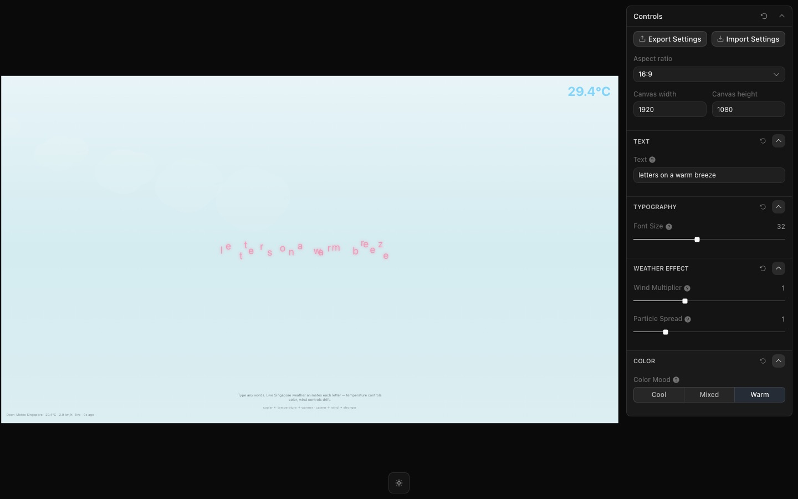

<div align="center">

<h1>textdrift</h1>

<p><b>Type words and watch them float.</b></p>

<p><i>A typography toy that colours and nudges each letter with the current weather in Singapore.</i></p>

<h6>


</h6>

<a href="https://textdrift.pages.dev"><b>Live demo</b></a> ·
<a href="#how-it-works"><b>How it works</b></a> ·
<a href="#run-it"><b>Run it</b></a>

<br><br>

<a href="https://textdrift.pages.dev"></a>

<sub>Live capture, 23 October 2026, typed text "letters on a warm breeze" with Color Mood on Warm. Singapore was 29.4 °C with a 2.9 km/h wind, so the letters barely move.</sub>

</div>

<br>

A one-day sketch from a "creative daily" series, built on the Pixel Point Toolcraft starter (React,
Vite, a side panel of schema-driven controls). Whatever you type in the **Text** field becomes a
row of loose letters on a Canvas 2D sky. Every 60 seconds the page asks
[Open-Meteo](https://open-meteo.com/) for the current temperature, wind speed and wind direction
at 1.35° N, 103.82° E, and those three numbers decide how the letters look and move.

## How it works

| Weather field | Drives |
|---|---|
| `temperature_2m` | Letter colour: soft blue at 22 °C, lavender at 28 °C, coral pink at 34 °C and above |
| `wind_speed_10m` | How far the letters are pushed off their resting place |
| `wind_direction_10m` | Which way they are pushed |

| Control | Effect |
|---|---|
| Text | The words drawn on the canvas |
| Font Size | 12 to 60 px |
| Wind Multiplier | Scales the wind push, 0 to 3× |
| Particle Spread | Spacing between letters, 0.5 to 3× |
| Color Mood | Shifts the colour scale: Cool reads the temperature 6 °C colder (bluer), Warm 6 °C warmer (pinker), Mixed as measured |

Each letter also bobs gently on its own. Clicking a letter shows a small panel with the
temperature, wind speed and direction driving it. Until the first request succeeds, the page
uses fallback values of 28 °C and a 5 km/h easterly. The 16:9 output frame is zoomed to fit
the screen, so the temperature headline top-right and the data stamp bottom-left stay in view.

## Run it

```bash
git clone https://github.com/parthchandak02/textdrift.git
cd textdrift
npm install
npm run dev      # starts Vite on a free port, 3002 by default
npm run build    # static site in dist/
```

<details>
<summary><b>Project layout</b></summary>

```
src/app/TextDriftCanvas.tsx   Weather fetch, letter particles, canvas drawing, tap panel
src/app/app-schema.ts         Toolcraft control panel definition
src/toolcraft/                Copied Toolcraft runtime and UI (Pixel Point)
e2e/                          Playwright acceptance and performance tests
brief.md                      The original creative brief
AGENTS.md, docs/toolcraft/    Toolcraft contributor rules
```

</details>

<details>
<summary><b>License</b></summary>

The Toolcraft runtime, UI and docs copied into this repo belong to Pixel Point and are covered
by the Toolcraft Designer License in [LICENSE.md](LICENSE.md); see [NOTICE.md](NOTICE.md).

</details>

<br>

<div align="center">
<sub>Built with React, Canvas 2D, Vite and Toolcraft. Weather from Open-Meteo.</sub>
</div>
