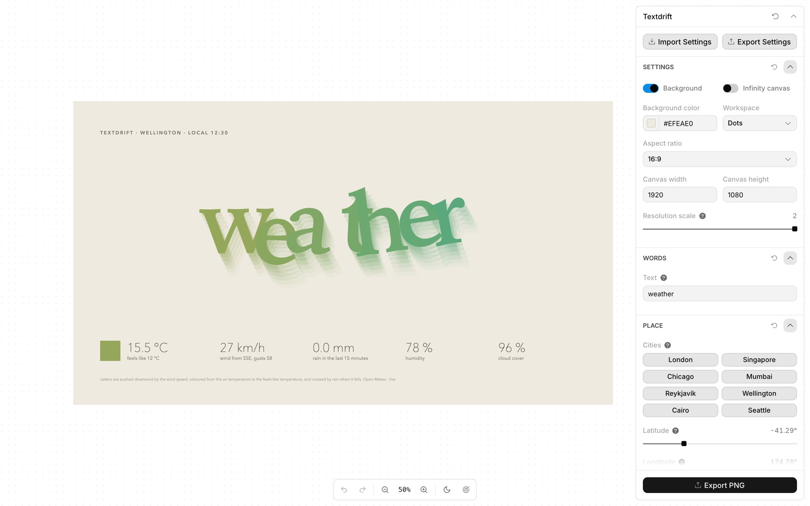

<div align="center">

<h1>Textdrift</h1>

<p><b>Your words, blown by today's weather.</b></p>

<p><i>Type anything and pick a city: its live wind pushes the letters downwind, its temperature colours them, and its rain falls across them.</i></p>

<h6>


</h6>

<a href="https://textdrift.pages.dev"><b>Live app</b></a> ·
<a href="#how-it-works"><b>How it works</b></a> ·
<a href="#run-it"><b>Run it</b></a>

<br><br>

<a href="https://textdrift.pages.dev"></a>

<sub>The default poster: Wellington's wind.</sub>

</div>

<br>

Textdrift sets a line of your words large and lets the current weather act on it. Each letter is
pushed downwind in proportion to the wind speed (the later letters further, as if peeled off),
jostled across the wind by the gusts, tilted, and followed by a fading trail. The colour runs from
the air temperature on the first letter to the feels-like temperature on the last. When it is
raining, streaks fall across the poster and lean with the wind. Below, the current temperature,
wind, rain, humidity and cloud cover are set out plainly.

Type up to 40 characters, pick one of eight cities (London, Singapore, Chicago, Mumbai, Reykjavík,
Wellington, Cairo, Seattle) or drag Latitude and Longitude, and choose a Typeface (serif, sans or
mono) and how strongly the wind moves the letters (Drift, 0 to 2×). The background can be changed
(dark colours flip the ink) or left out, and the poster exports as PNG or JPG at 2K, 4K or 8K.

## How it works

Current conditions come from the free [Open-Meteo forecast API](https://open-meteo.com/en/docs),
fetched once per place and cached. Every displacement is computed from the wind speed, direction
and gusts with a seeded random number per text, so the same words in the same weather always make
the same poster. Letters are kept inside the frame however hard it blows. If the API cannot be
reached, a labelled sample breeze is used.

The poster is drawn with Canvas 2D in a Web Worker at the exact zoomed backing resolution, and the
same drawing function renders the exported image. The editor shell, panel, settings import/export,
saved workspace and image export come from [Toolcraft](https://github.com/pixel-point/toolcraft)
(Pixel Point, MIT).

## Run it

```bash
git clone https://github.com/parthchandak02/textdrift.git
cd textdrift
npm install
npm run dev              # local editor; needs Node 22+
npm test                 # unit tests plus Toolcraft's contract checks
npm run verify:delivery  # full functional acceptance in a real browser
```

The live version is a static build (`npm run build`, then `dist/`) on Cloudflare Pages.

<details>
<summary><b>Project layout</b></summary>

```
src/textdrift/weather-data.ts       Open-Meteo request, parsing, cache, offline sample
src/textdrift/textdrift-draw.ts     Letter placement, trails, rain and the whole poster
src/textdrift/TextdriftCanvas.tsx   The live canvas: worker raster at the exact backing size
src/textdrift/textdrift-controls.ts Words, Place and Type controls; city shortcuts
src/app/app-schema.ts               Toolcraft schema: sections, canvas, image export
src/app/app-acceptance-data.ts      What every control must visibly do (checked in a real browser)
e2e/product-textdrift-*.spec.ts     Browser acceptance tests, one file per area (API stubbed)
src/toolcraft/                      Vendored Toolcraft runtime (do not edit)
```

</details>

<br>

<div align="center">
<sub>Built with Toolcraft, React and Canvas 2D. Weather from Open-Meteo.</sub>
</div>
